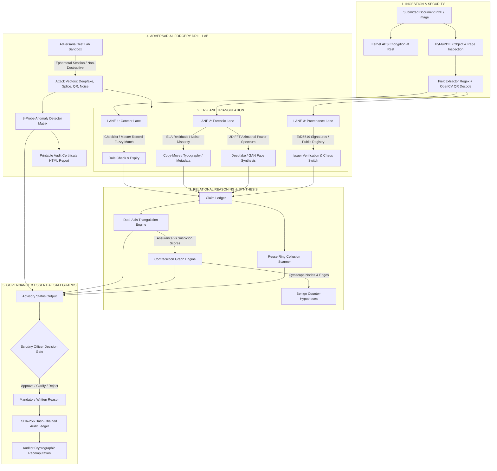

# TruthTrace 🛡️
> **AI-Powered Application Validation, Document Authentication & Regulatory Compliance Verification**  
> *Autonomous, Explainable, 100% Local Prototype for AICTE Approval Process Scrutiny*

[](https://python.org)
[](https://fastapi.tiangolo.com)
[](backend/tests/)
[](#)
[](#)

---

## 🏛️ Executive Summary

**TruthTrace** is an autonomous regulatory verification platform developed for the **AICTE Problem Statement: "AI-Powered Application Validation, Document Authentication and Regulatory Compliance Verification"**. 

It replaces error-prone, dogmatic automated checkers with an **explainable tri-lane triangulation architecture** (Content, Classical Forensics, Cryptographic Provenance) supported by a **Cross-Claim Contradiction Graph**, a **Multi-Application Reuse Ring Engine**, an interactive **Adversarial Forgery Simulation Lab**, and a **SHA-256 Hash-Chained Audit Ledger**.

TruthTrace strictly upholds the non-negotiable principle: **AI Only Advises**. Automated components can never set final or adverse regulatory orders; adverse actions strictly require an authenticated Scrutiny Officer, a mandatory written reason (>= 10 chars), and are permanently sealed into the cryptographic audit trail.

---

## 🌐 Live Demo

- **Frontend (GitHub Pages):** [https://sham-b.github.io/Truthtrace/](https://sham-b.github.io/Truthtrace/)
- **Backend API (Render Web Service):** [https://truthtrace-api.onrender.com](https://truthtrace-api.onrender.com) *(confirm actual URL in Render)*

> [!NOTE]
> **Free Tier Sleep & Automatic Reset:** The public demo is hosted on free tiers (GitHub Pages + Render free tier). When inactive for 15 minutes, the Render instance sleeps; the first request takes approximately ~1 minute to wake up while the frontend startup splash displays progress. The Render filesystem is ephemeral; SQLite storage and uploaded test files reset automatically on service reboot. The public demo uses synthetic data only. Anyone can switch roles and test uploads. Do not upload sensitive or real personal documents.

### Hosting Mode vs. Local Mode

| Dimension | Lean Hosting Mode (Render Free Tier) | Full Local Mode (Local Workstation) |
| :--- | :--- | :--- |
| **OCR & Text Recognition** | Fast PyMuPDF digital text layer; scanned non-text bitmaps flag `manual_review_required` | EasyOCR + PyTorch neural text extraction on CPU/GPU |
| **Infrastructure Vision** | OpenCV geometric contour & EXIF inspection | DETR neural object detection (`facebook/detr-resnet-50`) + OpenCV fallback |
| **Memory Footprint** | ~180-260 MB (strictly stays within 512 MB Render limit) | Unlimited local RAM |
| **Image / PDF Processing** | PDFs rendered at 110 DPI, images capped to 1600 px for forensic ELA & noise residual | Full native resolution |
| **LLM Advisory** | Deterministic template reasoning (`LLM_PROVIDER=none` or `template`) | Local Ollama (`qwen2.5:3b`) or Gemini API integration |
| **Dependencies** | Lean runtime (`requirements-render.txt`, ~15 wheels, ~120 MB total) | Full ML suite (`requirements.txt`, includes PyTorch/EasyOCR/Transformers) |

---

## 🚀 Quickstart (100% Local & Offline)

TruthTrace runs entirely on CPU without any cloud ingress/egress, external API keys, or paid services:

```bash
# 1. Clone repository and navigate to workspace
cd truthtrace

# 2. Install dependencies (if not already installed)
pip install -r requirements.txt

# 3. Launch TruthTrace (seeds database, creates keypairs, and starts server)
python run.py
```

Open your browser at:
- **Interactive Scrutiny Dashboard:** [http://127.0.0.1:8000](http://127.0.0.1:8000)
- **Interactive API Swagger Docs:** [http://127.0.0.1:8000/docs](http://127.0.0.1:8000/docs)
- **3-Minute Walkthrough Guide:** [docs/DEMO_SCRIPT.md](docs/DEMO_SCRIPT.md)

---

## 📐 Architecture & Tri-Lane Triangulation

TruthTrace evaluates submitted applications through three independent evidence lanes, a temporal concordance engine, an adversarial simulation sandbox, and a multi-institution collusion scanner:



---

## 🧪 Adversarial Test Lab: Forgery Simulation & Explanation

TruthTrace includes a dedicated **Adversarial Test Lab** designed for Scrutiny Officers and Compliance Auditors to evaluate how verification pipelines respond to sophisticated document tampering without risking production data:

- **Two-Panel Sandbox UI**: Left panel for selecting legitimate baseline documents (Affidavit, Lease Deed, Lab Photo, TER Receipt, State NOC) or uploading custom documents, and configuring multi-vector attacks; right panel for live canvas rendering, side-by-side visual diffs, and Triangulation decision scorecards.
- **Attack Vector Controls**:
  - *Deepfake Photo*: Generates synthetic facial modifications using dual-frequency sinusoidal perturbation ($f_1=24, f_2=16$ harmonics) simulating GAN deconvolution artifacts. *Note: The lab's synthetic attacks are generated by this project, so the results demonstrate the pipeline, not generalisation to real AI-generated forgeries.*
  - *Override Name*: Simulates typographic splicing and white-out tampering with mismatched font families (e.g. Courier-Bold over Helvetica).
  - *Noise & Rotation Sliders*: Applies mechanical scan angle skew and sensor Gaussian noise.
  - *Corrupt QR Signature*: Replaces genuine Ed25519 digital signatures with invalid cryptographic curves.
  - *Metadata Injection*: Injects consumer editing application tags (Canva, Adobe Photoshop) into the PDF binary stream.
- **8-Probe Anomaly Detector Matrix**: Real-time evaluation displaying passed/flagged status badges, plain-language explanations for flagged anomalies, and counterfactual hardening recommendations for unflagged probes.
- **Attack Wizard**: Guided interactive scenarios covering common real-world forgery archetypes (*Deepfake Signatory Face Swap*, *Forged Cryptographic Seal*, *Tenure Typographic White-Out*, *Canva Metadata Injection*, *Scanner Noise Skew*).
- **Ephemeral Chain-of-Custody**: All simulations run in isolated sessions (`storage/simulations/{session_id}.json`) without modifying production applications, while generating `ADVERSARIAL_SIMULATION` audit entries linked to the cryptographic SHA-256 audit ledger and exportable HTML reports with embedded hash signatures.

---

## 🛡️ AICTE Problem Statement: "Essential Safeguards" 1-to-1 Mapping

Every essential safeguard specified in the AICTE Problem Statement is strictly implemented and enforced:

| AICTE Essential Safeguard | Implementation in TruthTrace | Enforcing File / Module | Test Verification |
| :--- | :--- | :--- | :--- |
| **1. Advisory-Only AI Gate** | Automated components cannot enforce adverse actions (`reject`, `refer_for_inspection`, `mark_forged`). Adverse actions strictly require an authenticated Officer. | `backend/app/main.py` (`POST /decisions`) | `backend/tests/test_decision_gate.py` |
| **2. Mandatory Written Reason** | Final adverse orders fail with HTTP 400 if reason is omitted or under 10 characters. | `backend/app/main.py` (`record_officer_decision`) | `backend/tests/test_decision_gate.py` |
| **3. Server-Side RBAC Redaction** | `Institution` role never receives forensic internals, suspicion scores, detector heatmaps, or adversarial test lab access. | `backend/app/main.py` & `adversarial/router.py` | `backend/tests/test_rbac_redaction.py`, `test_adversarial_lab.py` |
| **4. Cryptographic Audit Chain** | Every action, check, order, and simulation is chained via `SHA-256(prev_hash + payload)`. Broken links pinpointed immediately. | `backend/app/audit.py` (`verify_audit_chain`) | `backend/tests/test_audit_chain.py`, `test_adversarial_lab.py` |
| **5. Standardized Status Vocab** | Strictly 6 statuses: `verified`, `mismatch_detected`, `expired`, `verification_pending`, `source_unavailable`, `manual_review_required`. Never outputs false "safe". | `backend/app/models.py` (`StatusEnum`) | `backend/tests/test_triangulation.py` |
| **6. Explainable Flags & Hypotheses** | Every flag has `reason_code`, `plain_language_reason`, normalized `bbox`, and 1–3 realistic benign explanations with settling evidence. | `backend/app/engine/claims.py` & `backend/rules/benign_hypotheses.yaml` | `backend/tests/test_temporal_rules.py` |
| **7. Configurable YAML Rules** | Checklists, temporal windows, handbook citations (`APH §...`) reside in YAML files, not hard-coded in code. | `backend/rules/*.yaml` | `backend/tests/test_temporal_rules.py` |
| **8. Encrypted at Rest** | Documents encrypted on disk using Fernet symmetric encryption. Secret auto-generated in `.env`. | `backend/app/security.py` (`save_encrypted_file`) | `backend/tests/smoke_test_phase_a.py` |

---

## 📊 PS Objective & Deliverable Traceability Matrix

| PS Objective / Requirement | Delivered Feature | Implementation Files |
| :--- | :--- | :--- |
| **Document Classification & Parsing** | PyMuPDF text & vector parser, OCR fallback, document classifier | `backend/app/ingest/loader.py`, `classify.py` |
| **Field Extraction & Normalization** | Regex & OpenCV QR code extraction for PID, dates, amounts, acres | `backend/app/ingest/extract.py` |
| **Content & Completeness Checking** | AICTE master record fuzzy matching, fee tiers, lease duration checks | `backend/app/lanes/content.py` |
| **Classical Document Forensics** | ELA, noise variance, copy-move clone detection, font span typography | `backend/app/lanes/forensic.py` |
| **Deepfake & GAN Facial Forensics** | 2D FFT azimuthal power spectrum roll-off & deconvolution grid analysis | `backend/app/adversarial/deepfake_detector.py` |
| **Adversarial Test Lab & Simulation** | Interactive two-panel attack simulator, Attack Wizard, HTML report export | `backend/app/adversarial/router.py`, `engine.py`, `frontend/app.js` |
| **Statutory Provenance Verification** | Ed25519 digital signature verification + mock statutory issuer endpoints | `backend/app/lanes/provenance.py`, `mock_issuers/` |
| **Network Outage Resilience** | Chaos Switch simulating mock issuer 503 outage and network failure | `backend/app/mock_issuers/router.py` |
| **Cross-Claim Contradiction Graph** | Cytoscape interactive graph rendering temporal and identity conflicts | `backend/app/engine/temporal.py`, `frontend/app.js` |
| **Regulatory Alerts Engine** | 6 alert types (missing, expiring, pending, anomaly, reuse, overdue) | `backend/app/engine/alerts.py` |
| **Adversarial Forgery Drill Suite** | 10 tampered attack archetypes + detection heatmap + EVAL.md | `backend/synth/forge.py`, `backend/eval/run_eval.py` |
| **Institution Pre-Flight Portal** | Content-only check + versioned document replacement & upload | `backend/app/main.py`, `frontend/index.html` |
| **Multi-Application Reuse Ring** | Cross-college duplicate registration numbers, pHash near-duplicates | `backend/app/engine/reuse_ring.py` |
| **Infrastructure Vision Assist** | Computer lab workstation and chair counter with non-fatal fallback | `backend/app/infra/vision.py` |
| **Check History & What Changed** | Immutable versioned ValidationRuns, snapshot deduplication, finding-level diff (Fixed / New / Still open), rules/doc change attribution | `backend/app/engine/runs.py`, `backend/app/main.py`, `frontend/app.js` |
| **Scrutiny Dashboard** | Scatter plot (Assurance x Suspicion), queue filters, bilingual Hindi viewer | `frontend/index.html`, `styles.css`, `app.js` |

---

## 📜 Check History & What Changed (Versioned Audit Runs)

Every official validation of an application is recorded as an immutable **Check #N** (`ValidationRun`) capturing:
- **Exact Snapshot:** Active document version hashes, normalized claims, applied checklist ID, rules version SHA-256, master record hash, and issuer availability state.
- **Snapshot Idempotency:** Re-evaluating an application with identical snapshot state returns the existing check with `reused: true` and shows a friendly toast: *"Nothing has changed since Check #N"*.
- **Finding-Level Diff:** Comparing any two checks highlights:
  - 🟢 **Fixed:** Issues resolved between runs.
  - 🟡 **New:** Issues introduced in the latest check.
  - ⚪ **Still Open:** Persisting issues (flagged *"Value changed"* if observed claim differs).
  - **Deterministic Plain Explanation:** e.g., *"Since Check #1: Accreditation certificate was replaced (v1 to v2). 1 issue fixed, 0 new, 2 still open."*
- **Role-Based Redaction:** Colleges only see content-lane findings without internal scores, hashes, or detector internals.
- **Concurrent Revision Guard:** Incremented on document replacements to prevent race conditions (returns HTTP 409 Conflict if state mutated during scrutiny).

---

## 🔌 AICTE Portal Integration Contract (`adapters/aicte_portal.py`)

TruthTrace is designed to plug directly into the live AICTE e-Governance Portal / ERP backend using a clean, documented REST contract:

### 1. Inbound: Fetch Institution Profile
```http
GET /api/v1/institutions/{pid}/master
Authorization: Bearer <AICTE_API_KEY>
X-Client: TruthTrace-Regulatory-Engine
```
**Response Contract:**
```json
{
  "status": "success",
  "data": {
    "pid": "1-1029384751",
    "name": "Aryabhata Institute of Engineering & Technology",
    "campus_address": "Plot 12, Institutional Area, Sector 62, Noida, UP - 201309",
    "mandatory_land_acres": 5.0,
    "approved_intake": 480,
    "ter_fee_mandated": 100000.0,
    "ter_transaction_id": "TER-2026-99120"
  }
}
```

### 2. Outbound: Push Scrutiny Advisory
```http
POST /api/v1/applications/{application_id}/validation-advisory
Authorization: Bearer <AICTE_API_KEY>
Content-Type: application/json
```
**Payload Contract:**
```json
{
  "application_id": "APP-2026-001",
  "system": "TruthTrace v1.0",
  "advisory_status": "verified",
  "assurance_score": 1.0,
  "suspicion_score": 0.0,
  "sufficiency": 3,
  "blind_spot_disclosure": "Forensic Blind-Spot Disclosure: Classical pixel forensics may not detect generative AI-inpainted modifications...",
  "findings_count": 0
}
```

---

## 🔍 Honest Limitations & Disclaimers

1. **Pixel Forensic Blind-Spots:**  
   As demonstrated in our empirical evaluation ([docs/EVAL.md](docs/EVAL.md)), classical pixel forensics (Error Level Analysis, noise variance) evaluates spatial frequency and compression disparity. Digital-native PDF alterations saved losslessly do not produce spatial pixel noise gradients. TruthTrace addresses this via **2D FFT spectral roll-off analysis**, **Ed25519 cryptographic provenance**, and **temporal concordance**.
2. **Degraded Historical Scans:**  
   Severely degraded physical photocopies (e.g. low-resolution faxed deeds from 1980) may hinder optical character extraction. When OCR confidence drops below 0.70, TruthTrace flags `manual_review_required` rather than making speculative assumptions.
3. **Offline CPU Optimization:**  
   TruthTrace is built for zero-cost, fully local CPU operation. The vision infrastructure assistant defaults to robust OpenCV geometric contour analysis if heavyweight DETR neural weights (`facebook/detr-resnet-50`) are not downloaded locally, ensuring zero application crashes.

---

## 🧪 Verification & Test Suite

Run the full automated pytest suite:
```bash
python -m pytest backend/tests/ -v
```
All 29 tests pass cleanly across all regulatory lanes, security gates, run history comparisons, and adversarial modules:
```
backend/tests/test_adversarial_lab.py::test_adversarial_lab_rbac PASSED
backend/tests/test_adversarial_lab.py::test_adversarial_wizard_scenarios PASSED
backend/tests/test_adversarial_lab.py::test_adversarial_simulation_clean_baseline PASSED
backend/tests/test_adversarial_lab.py::test_adversarial_simulation_deepfake_attack PASSED
backend/tests/test_adversarial_lab.py::test_adversarial_simulation_text_override_and_corrupt_qr PASSED
backend/tests/test_adversarial_lab.py::test_adversarial_export_report_and_audit_integrity PASSED
backend/tests/test_alerts.py::test_alerts_engine PASSED
backend/tests/test_audit_chain.py::test_hash_chained_audit_integrity PASSED
backend/tests/test_dashboard_polish.py::test_dashboard_static_and_scatter_api PASSED
backend/tests/test_decision_gate.py::test_officer_decision_gate_and_rbac PASSED
backend/tests/test_forensic_lane.py::test_forensic_lane_signals PASSED
backend/tests/test_forgery_drill.py::test_forgery_drill_run_and_results PASSED
backend/tests/test_infra_vision.py::test_infra_vision_lab_inspection PASSED
backend/tests/test_preflight.py::test_institution_preflight_and_versioned_replacement PASSED
backend/tests/test_rbac_redaction.py::test_rbac_redaction_for_institution_role PASSED
backend/tests/test_reuse_ring.py::test_reuse_ring_detection PASSED
backend/tests/test_run_history.py::test_diff_runs_correctness_and_value_changed PASSED
backend/tests/test_run_history.py::test_rules_changed_detection_in_diff PASSED
backend/tests/test_run_history.py::test_identical_snapshot_deduplication PASSED
backend/tests/test_run_history.py::test_immutability_no_update_or_delete PASSED
backend/tests/test_run_history.py::test_determinism_of_repeated_checks PASSED
backend/tests/test_run_history.py::test_replacement_resolving_expired_finding PASSED
backend/tests/test_run_history.py::test_institution_role_redaction PASSED
backend/tests/test_run_history.py::test_audit_chain_integrity_with_run_recorded PASSED
backend/tests/test_run_history.py::test_simulations_do_not_create_runs PASSED
backend/tests/test_run_history.py::test_revision_guard_conflict_409 PASSED
backend/tests/test_signature_verify.py::test_ed25519_signature_signing_and_verification PASSED
backend/tests/test_temporal_rules.py::test_temporal_and_identity_graph PASSED
backend/tests/test_triangulation.py::test_triangulation_decision_table PASSED
```
